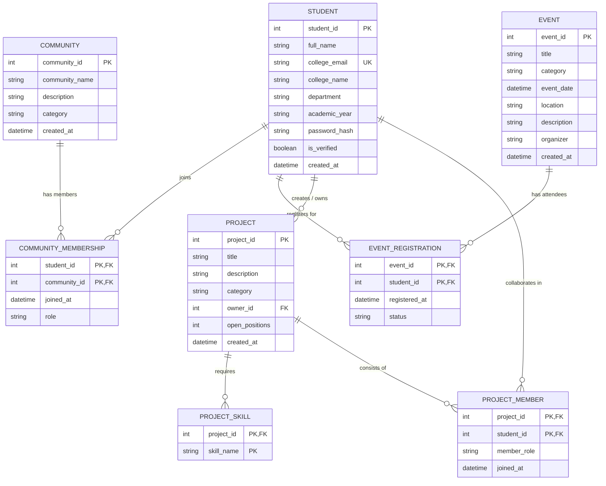

# CP2 – Entity-Relationship (ER) Modeling
## Project: SocioFy

---

## 1. Introduction & Overview

**SocioFy** is a college-exclusive social networking and collaboration platform. The platform empowers students to:
- Build student profiles and connect across departments.
- Create and join interest-based campus communities.
- Discover campus events and manage registrations.
- Showcase student projects, find teammates, and list required skills.

This document presents the conceptual and logical Entity-Relationship (ER) model for SocioFy, based on the normalized 3NF schema developed in CP1 (`01_normalization.md`).

---

## 2. Visual ER Diagram (Mermaid)

> **Note:** A graphical rendering of this ER diagram is also saved as `02_er_diagram.png` in this directory.

---

## 3. Entity Definitions & Attributes

### 3.1. Primary Entities (Strong Entities)

#### 1. `STUDENT`
Represents the verified students registered on the SocioFy platform.
- **`student_id`** (`INTEGER`, Primary Key): Unique identifier for each student.
- **`full_name`** (`VARCHAR(100)`): Full name of the student.
- **`college_email`** (`VARCHAR(150)`, Unique): Official campus email used for domain verification and authentication.
- **`college_name`** (`VARCHAR(150)`): Associated university or institution.
- **`department`** (`VARCHAR(100)`): Academic branch (e.g., Computer Science, Design).
- **`academic_year`** (`VARCHAR(20)`): Year of study (e.g., 1st Year, 2nd Year, Final Year).
- **`password_hash`** (`VARCHAR(255)`): Securely hashed user credentials.
- **`is_verified`** (`BOOLEAN`): Account verification status.
- **`created_at`** (`TIMESTAMP`): Account creation timestamp.

#### 2. `COMMUNITY`
Represents clubs, interest groups, and department forums created within the campus.
- **`community_id`** (`INTEGER`, Primary Key): Unique identifier for each community.
- **`community_name`** (`VARCHAR(100)`): Name of the community (e.g., "Web3 Developers", "Robotics Club").
- **`description`** (`TEXT`): Purpose and guidelines of the group.
- **`category`** (`VARCHAR(50)`): Type/Domain (e.g., Technology, Cultural, Sports, Academics).
- **`created_at`** (`TIMESTAMP`): Creation timestamp.

#### 3. `EVENT`
Represents campus activities, hackathons, workshops, and guest lectures.
- **`event_id`** (`INTEGER`, Primary Key): Unique identifier for each event.
- **`title`** (`VARCHAR(150)`): Name of the event.
- **`category`** (`VARCHAR(50)`): Type of event (e.g., Hackathon, Workshop, Fest).
- **`event_date`** (`TIMESTAMP`): Scheduled date and time.
- **`location`** (`VARCHAR(150)`): Venue or virtual link.
- **`description`** (`TEXT`): Detailed event overview.
- **`organizer`** (`VARCHAR(100)`): Hosting club, student chapter, or department.
- **`created_at`** (`TIMESTAMP`): Record creation timestamp.

#### 4. `PROJECT`
Represents peer-to-peer collaborative projects initiated by students.
- **`project_id`** (`INTEGER`, Primary Key): Unique identifier for each project.
- **`title`** (`VARCHAR(150)`): Project title.
- **`description`** (`TEXT`): Objectives, scope, and goals.
- **`category`** (`VARCHAR(50)`): Project domain (e.g., AI/ML, Web Development, IoT).
- **`owner_id`** (`INTEGER`, Foreign Key references `STUDENT(student_id)`): The student who initiated the project.
- **`open_positions`** (`INTEGER`): Count of team vacancies remaining.
- **`created_at`** (`TIMESTAMP`): Project posting timestamp.

---

### 3.2. Associative & Weak Entities (Bridging Relations)

#### 5. `COMMUNITY_MEMBERSHIP` (Resolves Many-to-Many: Student ↔ Community)
- **`student_id`** (`INTEGER`, Composite PK, FK → `STUDENT`): Enrolled student.
- **`community_id`** (`INTEGER`, Composite PK, FK → `COMMUNITY`): Joined community.
- **`joined_at`** (`TIMESTAMP`): Timestamp of joining.
- **`role`** (`VARCHAR(30)`): Member privilege level (e.g., Member, Moderator, Lead).

#### 6. `EVENT_REGISTRATION` (Resolves Many-to-Many: Student ↔ Event)
- **`event_id`** (`INTEGER`, Composite PK, FK → `EVENT`): Registered event.
- **`student_id`** (`INTEGER`, Composite PK, FK → `STUDENT`): Participating student.
- **`registered_at`** (`TIMESTAMP`): Registration timestamp.
- **`status`** (`VARCHAR(30)`): Current state (e.g., Registered, Confirmed, Waitlisted, Attended).

#### 7. `PROJECT_SKILL` (Multivalued Attribute Decomposed Relation)
- **`project_id`** (`INTEGER`, Composite PK, FK → `PROJECT`): Associated project.
- **`skill_name`** (`VARCHAR(50)`, Composite PK): Skill required (e.g., React, Python, Figma, Docker).

#### 8. `PROJECT_MEMBER` (Resolves Many-to-Many: Student ↔ Project Collaboration)
- **`project_id`** (`INTEGER`, Composite PK, FK → `PROJECT`): Associated project.
- **`student_id`** (`INTEGER`, Composite PK, FK → `STUDENT`): Participating collaborator.
- **`member_role`** (`VARCHAR(50)`): Role assigned (e.g., Frontend Dev, UI Designer, Researcher).
- **`joined_at`** (`TIMESTAMP`): Date joined the team.

---

## 4. Relationship & Cardinality Analysis

| Relationship | Entities Involved | Type | Cardinality | Explanation |
|---|---|---|---|---|
| **Community Membership** | `STUDENT` & `COMMUNITY` | Many-to-Many ($M:N$) | $1:N$ via `COMMUNITY_MEMBERSHIP` | A student can join zero or more communities ($0..N$); a community can have zero or more students ($0..N$). |
| **Event Registration** | `STUDENT` & `EVENT` | Many-to-Many ($M:N$) | $1:N$ via `EVENT_REGISTRATION` | A student can register for multiple events ($0..N$); an event can register multiple students ($0..N$). |
| **Project Ownership** | `STUDENT` & `PROJECT` | One-to-Many ($1:N$) | $1$ (Owner) to $0..N$ (Projects) | A student can create multiple projects ($0..N$); every project is owned by exactly one student ($1..1$). |
| **Project Teammates** | `STUDENT` & `PROJECT` | Many-to-Many ($M:N$) | $1:N$ via `PROJECT_MEMBER` | A student can join multiple project teams ($0..N$); a project can have multiple team members ($0..N$). |
| **Project Skills** | `PROJECT` & `PROJECT_SKILL` | One-to-Many ($1:N$) | $1$ to $1..N$ | A project can specify multiple technical skills ($1..N$). |

---

## 5. Integrity Constraints

1. **Entity Integrity**:
   - Every table contains an explicitly defined Primary Key (`PK`). Single-table entities use auto-incrementing integer IDs (`SERIAL`), while associative tables use composite primary keys to guarantee uniqueness.
2. **Referential Integrity**:
   - Foreign keys enforce parent-child relationships. Cascade operations (`ON DELETE CASCADE`) are specified on association tables (`COMMUNITY_MEMBERSHIP`, `EVENT_REGISTRATION`, `PROJECT_MEMBER`, `PROJECT_SKILL`) so deleting a student or project automatically cleans up orphaned mappings.
3. **Domain Integrity**:
   - Attributes enforce standard constraints: `NOT NULL` for mandatory attributes, `CHECK` constraints for enumerated values (e.g., status, academic year), and valid timestamps (`DEFAULT CURRENT_TIMESTAMP`).
4. **Unique Key Constraints**:
   - `STUDENT.college_email` is enforced with a `UNIQUE` constraint to prevent duplicate registrations.

---

## 6. Summary & Transition to CP3

The ER model strictly matches the 3NF normal form established in CP1:
- Zero data redundancy through normalized associative entities.
- Direct mapping to relational tables in PostgreSQL (`03_schema.sql`).
- Supports the full scope of SocioFy's campus networking, community discovery, event attendance, and project collaboration features.
